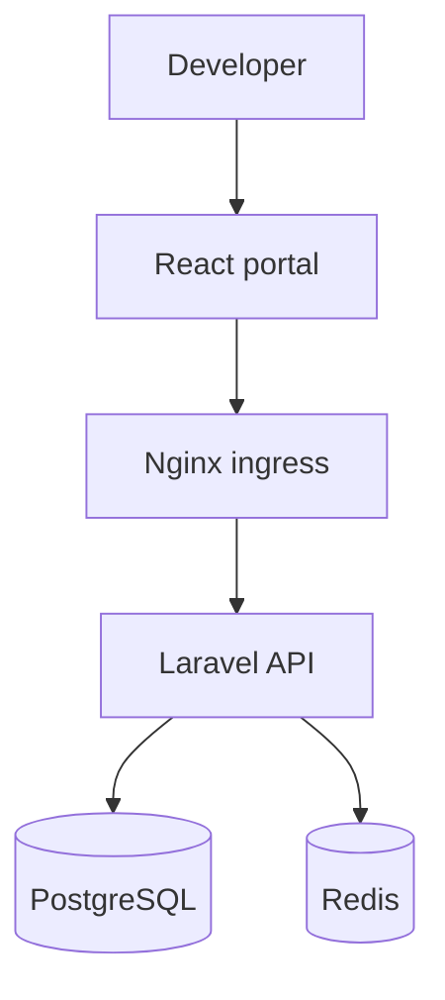

# Launchpad — Developer API Portal

A portfolio-grade developer portal demonstrating full-stack development, API integration, cloud-native delivery, automated testing and operational thinking.


## Why this project

The portal gives API consumers one place to discover services, review request examples, execute sandbox calls, inspect usage metrics and manage API keys. It uses fictional logistics APIs and contains no proprietary code, credentials or customer data.

## Capabilities

- Responsive landing page and searchable API catalogue
- Interactive API documentation and sandbox response
- Developer dashboard with usage and latency metrics
- API-key creation and revocation workflow
- Laravel REST endpoints with Sanctum-protected routes
- PostgreSQL models and migrations
- Redis-ready cache and queue configuration
- Docker Compose local environment
- Kubernetes Deployment, Service and Ingress manifests
- GitHub Actions build and test pipeline
- Playwright browser tests and PHPUnit API test
- Health endpoint covering database and Redis dependencies

## Architecture



## Technology

| Area | Technology |
|---|---|
| Frontend | React, React Router, Vite, responsive CSS |
| Backend | PHP 8.2+, Laravel 12, Sanctum, REST APIs |
| Data | PostgreSQL, Redis |
| Quality | PHPUnit, Playwright |
| Delivery | Docker, Nginx, GitHub Actions |
| Platform | Kubernetes manifests suitable for EKS |

## Quick start

### Frontend only

```bash
cd frontend
npm install
npm run dev
```

Open `http://localhost:5173`. The interface uses safe mock data, so it works without the API.

### Full stack with Docker

```bash
cp .env.example .env
docker compose up --build
docker compose exec api php artisan key:generate
docker compose exec api php artisan migrate
```

- Portal: `http://localhost:5173`
- Laravel API: `http://localhost:8080/api`
- Health: `http://localhost:8080/api/health`

## Tests

```bash
cd frontend
npm run test:e2e
```

```bash
cd backend
composer install
cp .env.example .env
php artisan key:generate
php artisan test
```

## API routes

| Method | Route | Purpose |
|---|---|---|
| GET | `/api/health` | Dependency health status |
| GET | `/api/catalog` | List API products |
| GET | `/api/catalog/{slug}` | API product details |
| POST | `/api/register` | Register a developer |
| POST | `/api/login` | Issue a Sanctum token |
| POST | `/api/logout` | Revoke the current token |
| GET | `/api/usage` | Authenticated usage metrics |
| GET | `/api/api-keys` | List a developer's keys |
| POST | `/api/api-keys` | Create a one-time visible key |
| DELETE | `/api/api-keys/{id}` | Revoke an owned key |

## Kubernetes

The `k8s/` directory provides separate frontend and API Deployments, a ClusterIP Service and an Ingress definition. Replace the sample image names and hostname before applying them.

```bash
kubectl apply -f k8s/
```

## Live frontend with GitHub Pages

The included `pages.yml` workflow builds and publishes the React interface. In the repository, open **Settings → Pages**, choose **GitHub Actions** as the source, and run the deployment workflow.

## Production considerations

- Store secrets in AWS Secrets Manager or Kubernetes Secrets.
- Build immutable images and replace the `latest` tag with commit SHAs.
- Add rate limiting, structured logging and correlation IDs at the API boundary.
- Send logs and metrics to ELK, CloudWatch or the organization's observability platform.
- Add OpenAPI generation and contract tests as the catalogue grows.

## Author

**Chu Fei Lee** — Full-Stack Software Engineer / Technical Lead

- [LinkedIn](https://www.linkedin.com/in/fei-lee-chu-202a0539)
- [GitHub](https://github.com/feigml17)
